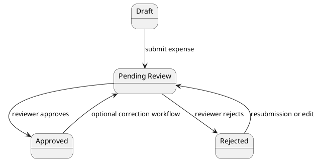

# Data Model: Shared Expense Management

## Domain entities

### UserAccount

| Field | Type | Notes |
|---|---|---|
| id | UUID | Unique account identifier |
| name | String | Display name |
| emailOrUsername | String | Login identity |
| passwordHash | String | Hashed credential store, never plain text |
| status | enum | Active/inactive; access to account information is enforced |

Validation rules:
- Login credentials are required before private account data is visible.
- One user identity maps to one account for the purpose of the feature.
- User accounts must not expose other users’ private records.

### Group

| Field | Type | Notes |
|---|---|---|
| id | UUID | Group identifier |
| name | String | Human-readable group name |
| creatorUserId | UUID | Group owner/manager |
| createdAt | DateTime | Creation timestamp |

Validation rules:
- A group must have a name.
- The creator is a member by default.
- Membership is managed separately from group definition.

### Membership

| Field | Type | Notes |
|---|---|---|
| id | UUID | Membership identity |
| groupId | UUID | Group reference |
| userId | UUID | Member identity |
| role | enum | Creator, manager, or member |
| isActive | boolean | Removed members lose current access |
| joinedAt | DateTime | Membership start |
| removedAt | DateTime | Optional removal timestamp |

Validation rules:
- Only active members can submit expenses to the group.
- Removed members retain historical records but lose current access to active group activity.

### Expense

| Field | Type | Notes |
|---|---|---|
| id | UUID | Expense identifier |
| groupId | UUID | Containing group |
| description | String | Required narrative |
| amount | BigDecimal | Positive total amount |
| date | LocalDate | Expense date |
| submitterUserId | UUID | User who created the expense |
| payerUserId | UUID | Single payer identity |
| allocationMethod | enum | EQUAL or PERCENTAGE |
| status | enum | DRAFT, PENDING_REVIEW, APPROVED, REJECTED |
| receiptPath | String | Optional image pointer |
| createdAt | DateTime | Timestamp |

Validation rules:
- Amount must be greater than zero.
- Date and description are required.
- One payer is required and must belong to the group context or be a valid external payer reference if defined by a future rule.
- A submitted expense is not active until approved.

### AllocationLine

| Field | Type | Notes |
|---|---|---|
| id | UUID | Allocation record |
| expenseId | UUID | Related expense |
| userId | UUID | Participant |
| method | enum | Equal or percentage derived |
| rawShare | BigDecimal | Raw share before rounding |
| roundedShare | BigDecimal | Final share in minor currency units |
| remainderRank | int | Rank used to distribute leftover cents |

Validation rules:
- For percentage splits, each percentage is between 0 and 100 inclusive and totals exactly 100%.
- For equal splits, each participant receives an equal share of the total.
- Final allocations reconcile exactly to the original expense amount using the largest-fractional-remainder rule.

### ReviewDecision

| Field | Type | Notes |
|---|---|---|
| id | UUID | Review record |
| expenseId | UUID | Expense under review |
| reviewerUserId | UUID | Authorized reviewer |
| decision | enum | APPROVE or REJECT |
| reason | String | Optional note |
| reviewedAt | DateTime | Timestamp |

Validation rules:
- Only authorized reviewers may act.
- Pending expenses change to approved or rejected only after a valid review decision.

### Notification

| Field | Type | Notes |
|---|---|---|
| id | UUID | Notification identity |
| groupId | UUID | Relevant group |
| recipientUserId | UUID | User receiving the notice |
| expenseId | UUID | Related expense |
| status | enum | Unread/read |
| message | String | Human-readable summary |
| createdAt | DateTime | Timestamp |

Validation rules:
- Notifications are sent only to active group members who are not the submitter, unless future business rules define differently.
- Non-members must never receive group-specific notifications.

### Balance

| Field | Type | Notes |
|---|---|---|
| id | UUID | Balance record |
| groupId | UUID | Group context |
| debtorUserId | UUID | User owing |
| creditorUserId | UUID | User owed |
| amount | BigDecimal | Net amount due |
| updatedAt | DateTime | Last recalculation |

Validation rules:
- All approved expenses and payments contribute to net balances.
- A payer’s own share must not be treated as a debt owed to themselves.
- Balances are recalculated after approval or payment settlement.

### Payment

| Field | Type | Notes |
|---|---|---|
| id | UUID | Payment record |
| groupId | UUID | Group context |
| payerUserId | UUID | User making the payment |
| payeeUserId | UUID | User receiving the payment |
| amount | BigDecimal | Recorded payment amount |
| date | LocalDate | Payment date |
| note | String | Optional description |
| createdAt | DateTime | Timestamp |

Validation rules:
- Amount must be greater than zero.
- Payment amount cannot exceed the current amount owed to the selected payee.
- A rejected or over-limit payment must not reduce the balance.

### ReportFilter

| Field | Type | Notes |
|---|---|---|
| userId | UUID | User requesting the report |
| groupId | UUID | Optional group filter |
| startDate | LocalDate | Lower bound |
| endDate | LocalDate | Upper bound |
| categories | enum[] | expenses, balances, payments |
| includeDetails | boolean | Whether the report is expanded |

Validation rules:
- Start date cannot be after end date.
- Only authorized data should be included in the output.
- Empty results should render a clear empty-state message.

### ReceiptImage

| Field | Type | Notes |
|---|---|---|
| id | UUID | Receipt record |
| expenseId | UUID | Related expense |
| path | String | File or object reference |
| mimeType | String | Allowed image media type |
| uploadedAt | DateTime | Timestamp |

Validation rules:
- Only allowed image types are accepted.
- Invalid or unreadable image files are rejected with user-facing feedback.

## Relationships

- One `UserAccount` can belong to many `Membership` records.
- One `Group` contains many `Membership` records and many `Expense` records.
- One `Expense` has many `AllocationLine` records and zero or one `ReceiptImage`.
- One `Expense` may have one `ReviewDecision` after submission.
- One `Group` has many `Balance` records and many `Payment` records.
- Many `Notification` records point to one `Group` and one `Expense`.

## State transitions

### Expense lifecycle

- `Draft`: local entry before validation and submission
- `Pending Review`: saved but not active; balances remain unchanged
- `Approved`: included in net balances
- `Rejected`: excluded from balances and visible to the submitter

### Payment lifecycle

- `Proposed` → `Recorded` when accepted
- `Recorded` may affect remaining balances
- Over-limit payments are rejected before changing the balance ledger

## Validation rules summary

- Expense amount must be greater than zero.
- Percentage allocations must each be between 0% and 100%, and they must total exactly 100%.
- Rounding leftovers must follow the largest fractional remainder rule, with entry order used for ties.
- Payments larger than the owed amount are rejected and the current amount due is shown.
- A removed member loses current group access, but historical records and outstanding settlements remain accessible to that user’s personal account.
- Access control must restrict group activity, receipts, and notifications to authorized members only.
